<h1 align="center">nvtop-web</h1>

<p align="center">
  Real-time telemetry for multi-GPU inference clusters.<br>
  Silicon-level NVML metrics and LLM serving metrics, fused into one zero-build dashboard.
</p>

<p align="center">
  <a href="https://github.com/jcartu/nvtop-web/releases"></a>
  <a href="https://github.com/jcartu/nvtop-web/blob/main/LICENSE"></a>
  
  
  
  
</p>

<br>

<p align="center">
  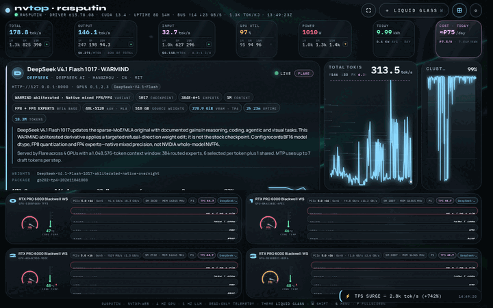
</p>

<p align="center">
  <sub>4× RTX PRO 6000 Blackwell &nbsp;·&nbsp; 4 Hz NVML &nbsp;·&nbsp; vLLM engine &nbsp;·&nbsp; WebGL shader wallpaper &nbsp;·&nbsp; zero scroll</sub>
</p>

<br>

## Overview

`nvtop-web` is a FastAPI service and a single HTML file. The service polls NVML at 4 Hz, scrapes the engine's Prometheus endpoint, and tails the engine boot log. Everything is pushed to the browser over one Server-Sent Events stream. The browser renders gauges and ribbons on Canvas2D and a shader wallpaper on WebGL. There is no bundler, no framework, no `node_modules`.

It is built for the machines people actually run inference on: 4×/8× RTX PRO 6000, Blackwell, H100, A100, and 4090 workstations serving Flare, vLLM, SGLang, or Ollama.

| Layer | What you see | Source |
|:--|:--|:--|
| **Silicon** | Utilization, VRAM allocation and fragmentation, PCIe TX/RX, power draw, cumulative kWh, temperature, fan curves | NVML, 4 Hz |
| **Serving** | TTFT p50/p95, ITL p50/p95, prefix-cache hit rate, KV-cache occupancy, request queue depth, live token throughput | Prometheus `/metrics` |
| **Boot** | Weight loading, CUDA graph capture, warmup, structured progress bars with learned ETA | Engine stdout |
| **Surface** | Container-query layout, 13 WebGL shader wallpapers, adaptive GPU throttling | Single HTML file |

### Model identity

The model card separates the **serving alias** from the **loaded weight identity**. Flare's
`/v1/models` root identifies the checkpoint even when the server advertises a generic alias;
the running process identifies the compiled package. Config/model-card metadata comes from an
exact local checkpoint match under `NVTOP_MODEL_ROOTS` (colon-separated roots; default
`/mnt/2king/models`). Ambiguous aliases and missing explicit checkpoints do not borrow metadata
from another installed variant.

DeepSeek V4.1 Flash descriptions distinguish the original and 1017 checkpoints, stock and
WARMIND/abliterated derivatives, native mixed FP8/FP4, lossless CSF, and NVIDIA NVFP4. The card
also shows available architecture, expert routing, serving context, GPU parallelism, and MTP
drafting facts. Unknown variants retain their exact identity rather than being silently relabelled.
Packed quantized tensors and Flare payload bytes are not presented as logical parameter counts.

Flare packages can reside outside the source checkpoint roots. The **Weights** row names the API
root, **Package** names the active compiled package, and their tooltips show the metadata/runtime
paths. A footprint labelled **source weights** belongs to the source checkpoint, not the compiled
package. New provenance fields respect `NVTOP_MASK_NAMES=1`.

<br>

## Silicon telemetry

<table>
  <tr>
    <td width="55%" valign="top">
      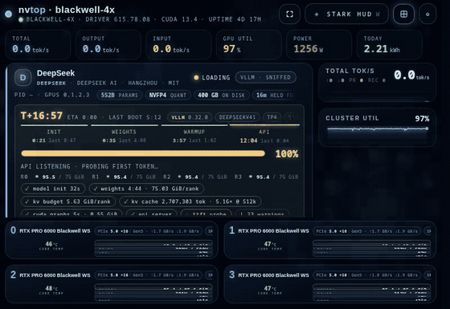
    </td>
    <td width="45%" valign="top">
      <h3>One card per GPU</h3>
      <p>Each card is a dense, legible instrument cluster. Utilization is drawn as a speedometer with a 60-second trail. VRAM is split into allocated, reserved, and fragmented segments. PCIe TX/RX are plotted as paired ribbons.</p>
      <p>Power is integrated into cumulative kWh per GPU and persisted across restarts, so a week of serving reads as a single number.</p>
      <ul>
        <li>4 Hz NVML sampling with per-field delta encoding</li>
        <li>Thermometer with throttle-threshold markers from NVML</li>
        <li>Fan curve overlay, actual vs. target RPM</li>
        <li>KV-cache occupancy and prefix-cache hit rate, per engine</li>
      </ul>
    </td>
  </tr>
</table>

<br>

## Shader wallpapers

<table>
  <tr>
    <td width="45%" valign="top">
      <h3>13 live WebGL scenes</h3>
      <p>Night City, Oblivion, Arrakis, Tokyo, Lumon, The Grid, MUTHUR, Jarvis, and more. Every scene is a single fragment shader rendered at vsync behind the telemetry layer.</p>
      <p>The wallpaper is <strong>never allowed to compete with inference</strong>. The renderer reads the live NVML utilization stream and scales its draw budget inversely with GPU load. At peak inference load it drops to zero draw calls and holds the last frame.</p>
      <ul>
        <li>Adaptive throttle: 100% → 0% draw calls as load rises</li>
        <li>Resolution scaling before frame skipping</li>
        <li>Pauses on hidden tabs and inactive windows</li>
        <li>Cycle with <kbd>W</kbd>, pin with <code>NVTOP_THEME</code></li>
      </ul>
    </td>
    <td width="55%" valign="top">
      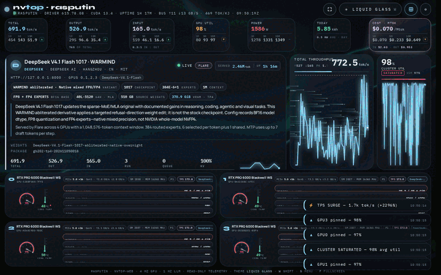
    </td>
  </tr>
</table>

<br>

## Launch sequence and throughput

<table>
  <tr>
    <td width="50%" valign="top">
      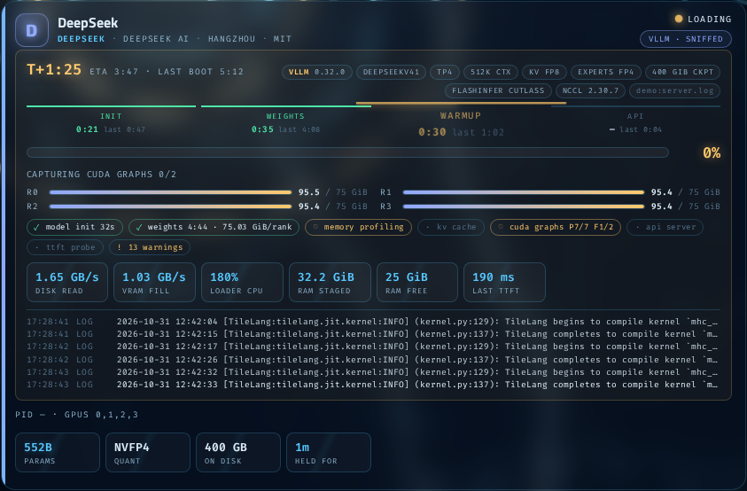
    </td>
    <td width="50%" valign="top">
      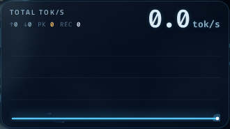
    </td>
  </tr>
  <tr>
    <td valign="top">
      <h4>Boot-log sniffer</h4>
      <p>vLLM and SGLang startup output is parsed into stages: weight loading, KV allocation, CUDA graph capture, warmup. Each stage gets a progress bar. ETAs are predicted from previous boots of the same model on the same hardware and refine as the run progresses.</p>
    </td>
    <td valign="top">
      <h4>Serving metrics</h4>
      <p>Token throughput is rendered as a speedometer with a 5-minute ribbon. TTFT and ITL are shown as p50/p95 bands. Queue depth, running requests, and swapped requests are read directly from the engine's Prometheus histograms and gauges.</p>
    </td>
  </tr>
</table>

<br>

## Layout

The layout is driven entirely by CSS container queries. In `fit` mode the dashboard never scrolls; it reflows GPU cards, ribbons, and the serving panel into whatever viewport it is given.

Model descriptions remain visible in both layouts. The card shows the model title, serving engine,
variant/specification chips, full descriptive text, and separate weight/package identities. Long
names wrap on narrow screens. On short fit-mode windows, the model band scrolls independently
so the GPU cards remain on screen.

<table>
  <tr>
    <td width="50%" align="center" valign="top">
      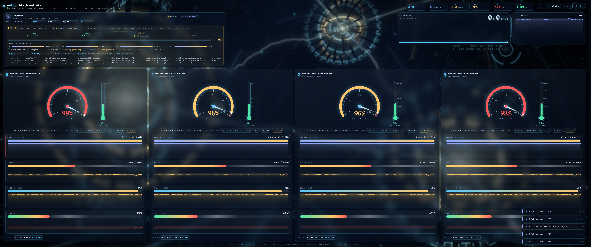
      <br><sub><b>Ultrawide</b> · four cards in a single row, ribbons full-width</sub>
    </td>
    <td width="25%" align="center" valign="top">
      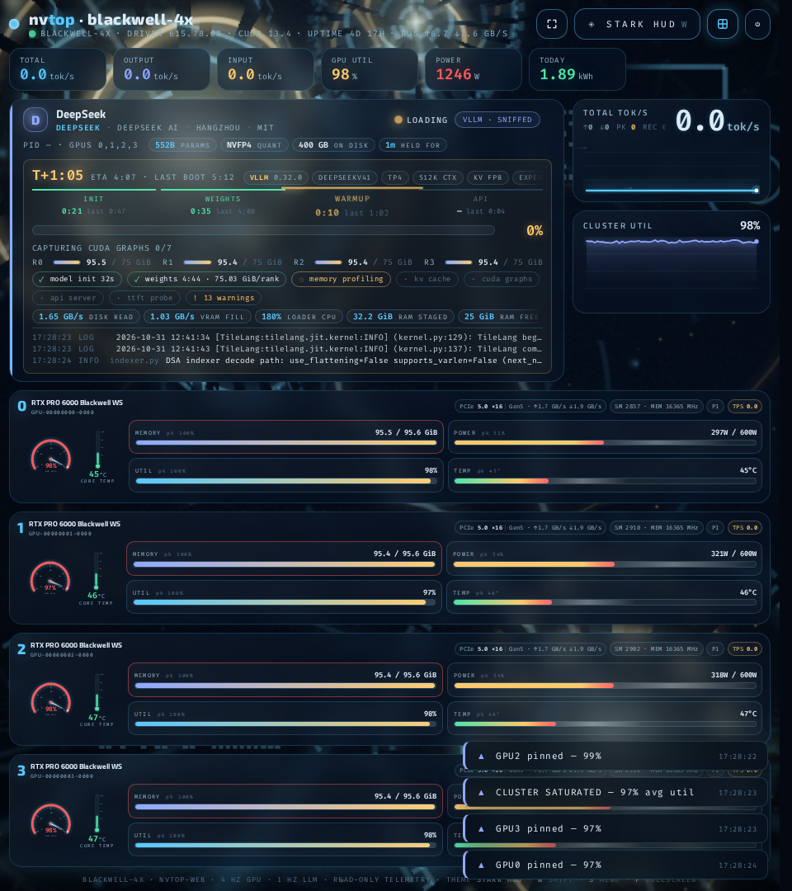
      <br><sub><b>Portrait</b> · stacked cards, condensed gauges</sub>
    </td>
    <td width="25%" align="center" valign="top">
      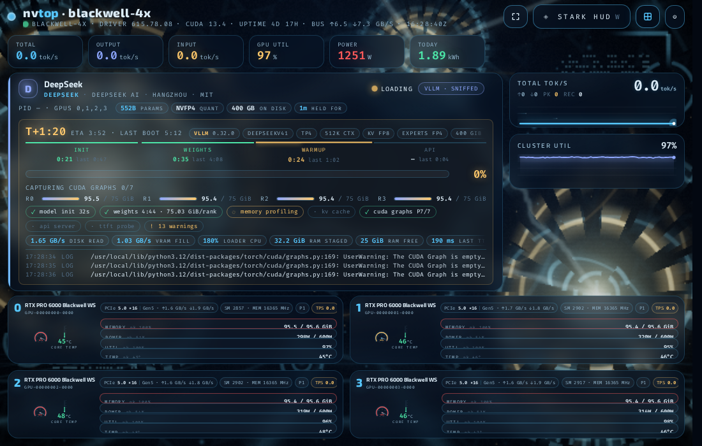
      <br><sub><b>Tile</b> · 50% screen, essentials only</sub>
    </td>
  </tr>
</table>

<br>

## Theme gallery

<table>
  <tr>
    <td align="center"><a href="docs/media/theme-liquidglass.png">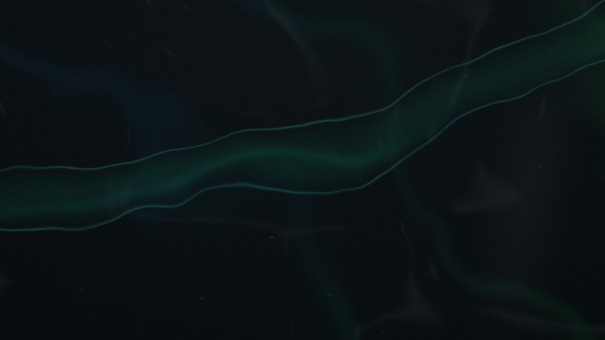</a><br><sub>Liquid Glass</sub></td>
    <td align="center"><a href="docs/media/theme-chrome.png">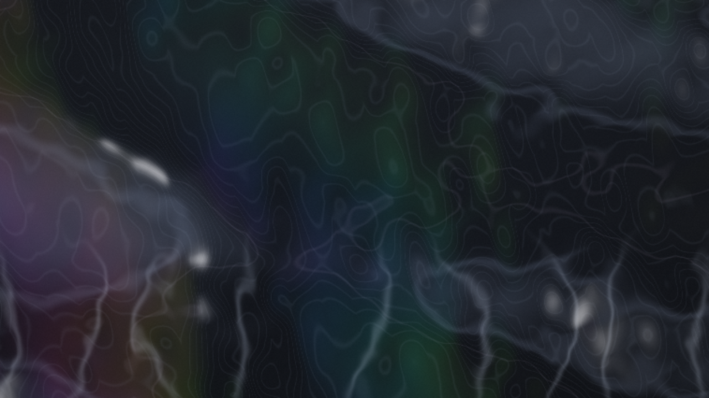</a><br><sub>Liquid Chrome</sub></td>
    <td align="center"><a href="docs/media/theme-thermalscan.png">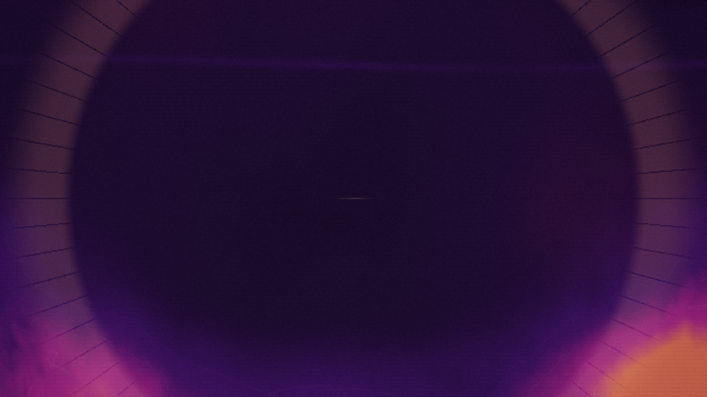</a><br><sub>Thermal Scan</sub></td>
    <td align="center"><a href="docs/media/theme-ditherpunk.png">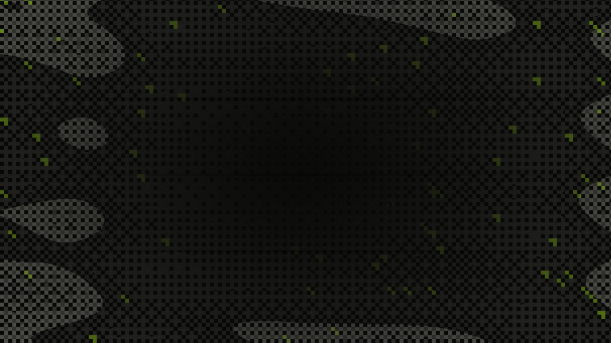</a><br><sub>Ditherpunk</sub></td>
  </tr>
  <tr>
    <td align="center"><a href="docs/media/theme-nightcity.png">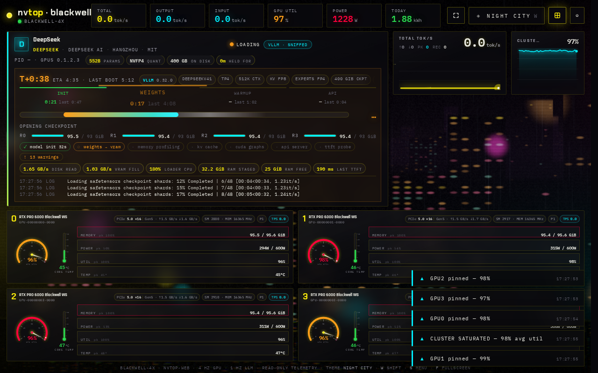</a><br><sub>Night City</sub></td>
    <td align="center"><a href="docs/media/theme-oblivion.png">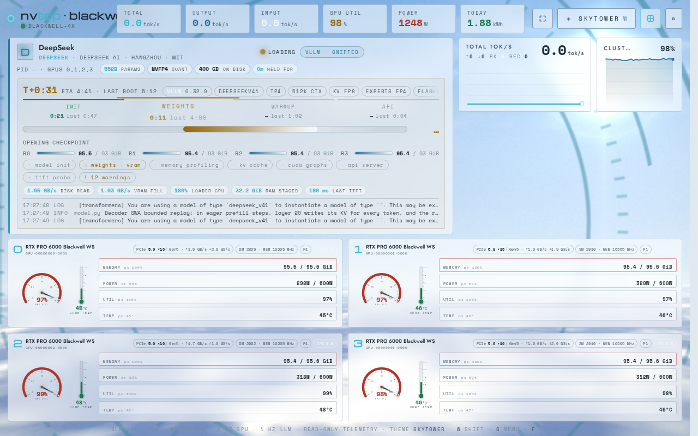</a><br><sub>Oblivion</sub></td>
    <td align="center"><a href="docs/media/theme-arrakis.png">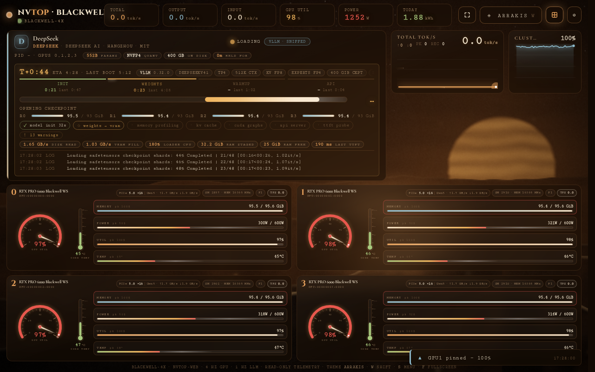</a><br><sub>Arrakis</sub></td>
    <td align="center"><a href="docs/media/theme-thegrid.png">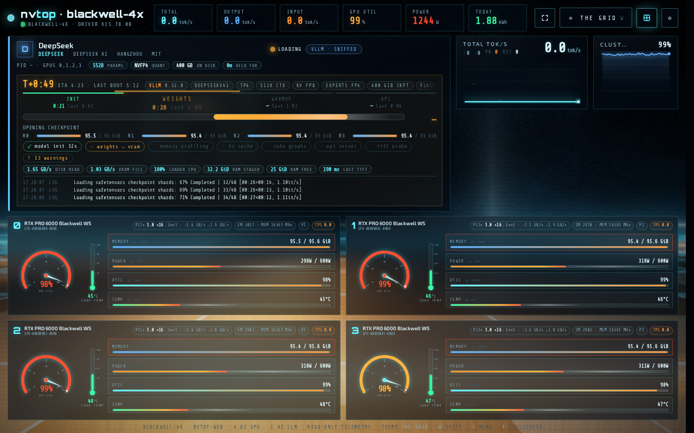</a><br><sub>The Grid</sub></td>
  </tr>
  <tr>
    <td align="center"><a href="docs/media/theme-tokyo.png">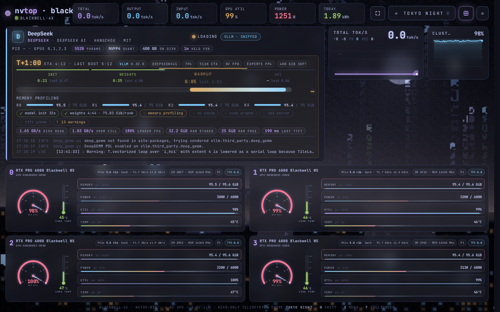</a><br><sub>Tokyo</sub></td>
    <td align="center"><a href="docs/media/theme-lumon.png">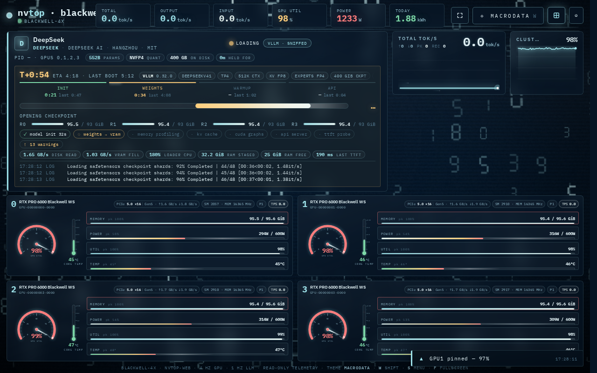</a><br><sub>Lumon</sub></td>
  </tr>
</table>

<p align="center"><sub>Plus Jarvis, MUTHUR, Ares, 2049, Apex, Construct, and Gargantua — 17 themes, all pure fragment shaders. Full 4K capture: <a href="docs/media/dashboard.png">dashboard.png</a></sub></p>

<br>

## Architecture

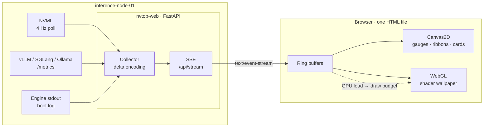

One process, one stream, one file. The collector merges all three sources into a single JSON frame per tick and only emits fields that changed. The browser keeps ring buffers for every series and draws from them on `requestAnimationFrame`. No polling from the client, no WebSocket negotiation, no reconnect logic beyond what `EventSource` gives you for free.

<br>

## Quickstart

### Local

```bash
git clone https://github.com/jcartu/nvtop-web.git
cd nvtop-web
python -m venv .venv && source .venv/bin/activate
pip install -r requirements.txt

# Run with optional auth and metrics endpoint:
NVTOP_PORT=8801 python app.py
```

Open `http://localhost:8801`.

### Docker

```bash
docker run -d --name nvtop-web \
  --gpus all \
  --network host \
  -e NVTOP_METRICS_URL=http://127.0.0.1:8000/metrics \
  -v nvtop-state:/var/lib/nvtop-web \
  ghcr.io/jcartu/nvtop-web:latest
```

### systemd

```ini
# /etc/systemd/system/nvtop-web.service
[Unit]
Description=nvtop-web GPU telemetry dashboard
After=network-online.target

[Service]
User=nvtop
Environment=NVTOP_METRICS_URL=http://127.0.0.1:8000/metrics
Environment=NVTOP_ENGINE_LOG=/var/log/vllm/engine.log
ExecStart=/opt/nvtop-web/.venv/bin/python app.py
Restart=always
RestartSec=2

[Install]
WantedBy=multi-user.target
```

```bash
sudo systemctl enable --now nvtop-web
```

<br>

## Configuration

All options are environment variables. CLI flags of the same name override them.

| Variable | Default | Description |
|:--|:--|:--|
| `NVTOP_HOST` | `0.0.0.0` | Bind address |
| `NVTOP_PORT` | `8801` | Bind port |
| `NVTOP_POLL_HZ` | `4` | NVML sampling rate |
| `NVTOP_METRICS_URL` | — | Engine Prometheus endpoint. Comma-separate for multiple engines |
| `NVTOP_ENGINE` | `auto` | `vllm`, `sglang`, `ollama`, or `auto` |
| `NVTOP_ENGINE_LOG` | — | Path to engine stdout for boot-log parsing |
| `NVTOP_GPUS` | all | Comma-separated NVML indices to display |
| `NVTOP_THEME` | `nightcity` | Default wallpaper. `none` disables WebGL |
| `NVTOP_LAYOUT` | `fit` | `fit` (no scroll) or `flow` |
| `NVTOP_STATE_DIR` | `~/.local/state/nvtop-web` | Persisted kWh counters and ETA models |
| `NVTOP_HOSTNAME` | system | Label shown in the header, e.g. `rig-01` |

<br>

## Keyboard

| Key | Action |
|:--|:--|
| <kbd>W</kbd> | Cycle wallpaper |
| <kbd>L</kbd> | Toggle layout, `fit` ↔ `flow` |
| <kbd>D</kbd> | Toggle detail density |
| <kbd>Space</kbd> | Freeze the stream for inspection |
| <kbd>F</kbd> | Fullscreen |
| <kbd>1</kbd> … <kbd>8</kbd> | Focus a single GPU |
| <kbd>Esc</kbd> | Return to overview |

<br>

## Production

Put `nvtop-web` behind Nginx. SSE requires `proxy_buffering off;`; without it the stream will stall until the buffer fills.

```nginx
server {
    listen 443 ssl http2;
    server_name gpu-cluster.internal;

    location / {
        proxy_pass         http://127.0.0.1:8801;
        proxy_http_version 1.1;
        proxy_set_header   Host $host;
        proxy_set_header   X-Forwarded-For $proxy_add_x_forwarded_for;
    }

    location /api/stream {
        proxy_pass         http://127.0.0.1:8801/api/stream;
        proxy_http_version 1.1;
        proxy_set_header   Connection "";
        proxy_buffering    off;
        proxy_cache        off;
        proxy_read_timeout 3600s;
        chunked_transfer_encoding on;
    }
}
```

### Built-in Authentication

nvtop-web includes built-in session authentication:
1. Place credentials in `.auth.json` (gitignored):
   ```json
   {
     "user": "admin",
     "pass_sha256": "<sha256-hash-of-password>"
   }
   ```
2. Or export environment variables:
   ```bash
   export NVTOP_AUTH_USER="admin"
   export NVTOP_PASS_SHA256="<sha256-hash-of-password>"
   ```
Sessions are signed with an HMAC secret stored in `.session-secret` (30-day `HttpOnly` cookie). If `.auth.json` is omitted, authentication is bypassed for local/trusted networks.

<br>

## Engine support

| Engine | Serving metrics | Boot log | Notes |
|:--|:--:|:--:|:--|
| vLLM | ✓ | ✓ | TTFT, ITL, prefix cache, KV usage, queue, swapped |
| SGLang | ✓ | ✓ | TTFT, ITL, radix cache hit rate, running/queued |
| Flare | ✓ | — | Auto-discovered `flare run`; prompt/output TPS, completed requests, active/queued requests, KV-page occupancy; no fabricated latency metrics |
| Ollama | ✓ | — | Token throughput and request counts |
| Any Prometheus exporter | partial | — | Generic histogram and gauge mapping via `NVTOP_METRICS_MAP` |

## Hardware

Tested on RTX PRO 6000 Blackwell, H100 SXM/PCIe, A100, and RTX 4090. Anything NVML reports will render; features gated on newer NVML fields degrade gracefully on older drivers. Driver 535 or newer is recommended.

<br>

## Contributing

Issues and pull requests are welcome. The frontend lives in a single file, `static/index.html`; shaders are in `static/themes/`. Adding a wallpaper means dropping in one fragment shader and one line in the theme registry.

## License

MIT. See [LICENSE](LICENSE).
