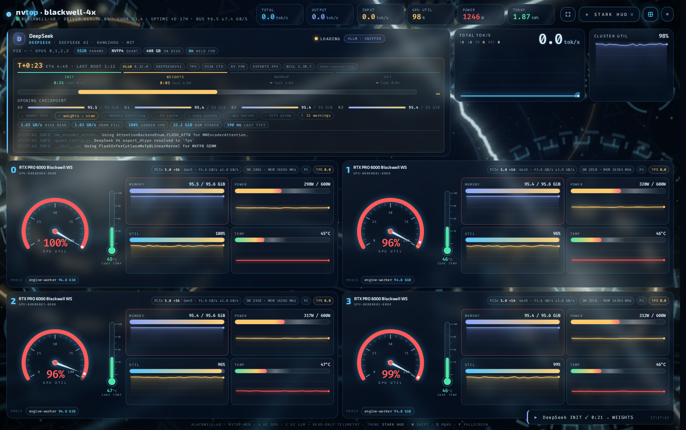

<div align="center">

<br />


<br />
<br />

# nvtop-web

### A cinematic, zero-build telemetry dashboard for multi-GPU inference clusters.

**Hardware truth from NVML. Serving truth from your LLM engine. One canvas. 60 fps.**

<br />

[](https://fastapi.tiangolo.com)
[](https://www.python.org)
[](https://developer.nvidia.com/cuda-toolkit)
[](https://developer.nvidia.com/nvidia-management-library-nvml)
[](#-13-live-webgl-shader-themes)
[](#-container-query-responsive-canvas)
[](LICENSE)

<br />

[**Features**](#-features) · [**Showcase**](#-showcase) · [**Architecture**](#-architecture) · [**Quickstart**](#-quickstart) · [**Shortcuts**](#-keyboard-shortcuts) · [**Production**](#-production-deployment)

<br />


<sub>Live recording · 4× RTX PRO 6000 Blackwell · vLLM serving · Night City theme</sub>

<br />

</div>

<br />

> **nvtop-web** is what happens when `nvtop`, Grafana, and a Blade Runner title sequence are left in a room together.
> It bridges low-level silicon telemetry with high-level LLM serving metrics, renders it all on a single-file HTML canvas with no build step, and wraps it in live WebGL wallpapers that throttle themselves out of the way the moment your GPUs get busy.

<br />

## ✨ Features

<table>
<tr>
<td width="50%" valign="top">

### ⚡ The Dual Telemetry Engine

Two data planes, one stream.

**Hardware plane** — NVML polled at **4 Hz** per device:
- SM / memory / encoder utilization
- VRAM allocation & fragmentation
- PCIe TX/RX throughput per lane
- Power draw with **cumulative energy accumulation** (Wh / kWh)
- Thermals, fan curves, clocks, throttle reasons

**Serving plane** — scraped from your engine's Prometheus `/metrics`:
- **TTFT** p50 / p95
- **ITL** (inter-token latency) p50 / p95
- Prefix-cache hit rates
- KV-cache occupancy
- Running / waiting / swapped request queues
- **Token throughput speedometer** (prompt + generation)

Works out of the box with **vLLM**, **SGLang**, and **Ollama**.

</td>
<td width="50%" valign="top">

### 📐 Container-Query Responsive Canvas

**Zero build step.** One `index.html`. No bundler, no framework, no `node_modules`.

Layout is driven entirely by **CSS container queries**, not viewport breakpoints — so every panel reshapes itself based on the space it actually has.

- **Ultrawide** — 4 GPU cards shoulder-to-shoulder with full inference panels
- **Portrait / mobile** — stacked vertical telemetry
- **Tiled 50% window** — compressed density mode
- **`fit` mode** — the whole dashboard locks to the viewport with **zero scroll**, ever
- **`flow` mode** — natural document flow for long engine logs

Drop it on a wall-mounted display, a phone, or a quarter of a 49" monitor. It just fits.

</td>
</tr>
<tr>
<td width="50%" valign="top">

### 🌌 13 Live WebGL Shader Themes

Not static wallpapers — **real-time fragment shaders** running at vsync behind your telemetry.

Night City · Oblivion · Arrakis · Tokyo · Lumon · The Grid · MUTHUR · Jarvis · and five more.

**Adaptive GPU throttling** watches NVML utilization and automatically steps the shader down (resolution scale → frame skip → static freeze) when inference load climbs. **The dashboard never steals compute from the model.**

Each theme recolors every gauge, glyph, and glow to match. Cycle with a single keypress.

</td>
<td width="50%" valign="top">

### 🚀 Engine Boot Sniffer & Launch Progress

Model loading is a black box. Not anymore.

nvtop-web tails your engine's startup log in real time and parses the boot sequence into **structured progress**:

- Weight shard download / mmap
- CUDA graph capture
- KV-cache profiling & allocation
- Torch compile stages
- HTTP server readiness

Every stage renders as a progress bar with a **learned ETA** — nvtop-web records how long each phase took for a given model weight size and predicts the remaining time on subsequent launches. Launch a 70B and know you've got 4 minutes to get coffee.

</td>
</tr>
</table>

<br />

## 🎬 Showcase

### Theme Cycling

<div align="center">

<br />
<sub>Press <kbd>W</kbd>. Every shader, every gauge palette, every glow — live.</sub>
</div>

<br />

### The GPU Card

<div align="center">

<br />
<sub>Utilization speedometer · thermometer with throttle markers · VRAM & KV-cache gauges · PCIe lane meters</sub>
</div>

<br />

### Inference Panels

<div align="center">
<table>
<tr>
<td width="50%" align="center">

<br />
<sub><b>Throughput & Latency</b> — tok/s speedometer, TTFT & ITL percentile ribbons, prefix-cache hit rate</sub>
</td>
<td width="50%" align="center">

<br />
<sub><b>Launch Sequence</b> — parsed vLLM boot log, per-stage progress bars, learned ETA</sub>
</td>
</tr>
</table>
</div>

<br />

### One Canvas, Every Screen

<div align="center">
<table>
<tr>
<td width="50%" align="center" valign="top">

<br />
<sub><b>Ultrawide</b> · 4 GPUs · full telemetry</sub>
</td>
<td width="25%" align="center" valign="top">

<br />
<sub><b>Portrait</b> · mobile</sub>
</td>
<td width="25%" align="center" valign="top">

<br />
<sub><b>Tiled</b> · 50% window · zero scroll</sub>
</td>
</tr>
</table>
</div>

<br />

### Theme Gallery

<div align="center">
<table>
<tr>
<td align="center"><br /><sub><b>Night City</b></sub></td>
<td align="center"><br /><sub><b>Oblivion</b></sub></td>
<td align="center"><br /><sub><b>Arrakis</b></sub></td>
</tr>
<tr>
<td align="center"><br /><sub><b>The Grid</b></sub></td>
<td align="center"><br /><sub><b>Tokyo</b></sub></td>
<td align="center"><br /><sub><b>Lumon</b></sub></td>
</tr>
</table>
<sub>+ MUTHUR · Jarvis · and five more. Full list in <a href="#-keyboard-shortcuts">Shortcuts</a>.</sub>
</div>

<br />

### Full Resolution

<div align="center">

</div>

<br />

## 🏗 Architecture

nvtop-web is a thin FastAPI process that fuses two sources into one **Server-Sent Events** stream. The browser does the rest.

```
┌──────────────────────────────────────────────────────────────────────────────────────┐
│                                   inference-node-01                                  │
│                                                                                      │
│   ┌───────────────────┐    ┌───────────────────────┐    ┌──────────────────────┐   │
│   │   NVIDIA Driver    │    │   vLLM / SGLang /     │    │   Engine stdout /    │   │
│   │   (NVML)           │    │   Ollama              │    │   journald / file    │   │
│   │                    │    │   :8000/metrics       │    │                      │   │
│   │  GPU0 GPU1 GPU2 …  │    │   (Prometheus text)   │    │  "Loading weights…"  │   │
│   └─────────┬──────────┘    └───────────┬───────────┘    └──────────┬───────────┘   │
│             │ 4 Hz                      │ 1 Hz scrape              │ tail -f        │
│             ▼                           ▼                          ▼                │
│   ┌──────────────────────────────────────────────────────────────────────────────┐  │
│   │                        nvtop-web  ·  FastAPI  ·  :8801                       │  │
│   │                                                                              │  │
│   │   ┌──────────────┐   ┌───────────────────┐   ┌──────────────────────────┐   │  │
│   │   │ nvml_poller  │   │ metrics_scraper   │   │ boot_sniffer             │   │  │
│   │   │ util · mem   │   │ TTFT · ITL · tok/s│   │ stage parser · ETA model │   │  │
│   │   │ pcie · power │   │ kv% · prefix-hit  │   │ (learned per weight GB)  │   │  │
│   │   │ energy ∑     │   │ queue depths      │   │                          │   │  │
│   │   └──────┬───────┘   └─────────┬─────────┘   └────────────┬─────────────┘   │  │
│   │          └──────────────┬──────┴───────────────────────────┘                 │  │
│   │                         ▼                                                    │  │
│   │              ┌───────────────────────┐        ┌────────────────────────┐     │  │
│   │              │  frame_merger         │        │  auth                  │     │  │
│   │              │  single JSON frame    │        │  SHA-256 pw · HMAC     │     │  │
│   │              │  @ 4 Hz               │        │  session cookie        │     │  │
│   │              └───────────┬───────────┘        └────────────────────────┘     │  │
│   └──────────────────────────┼───────────────────────────────────────────────────┘  │
│                              │  GET /api/stream   (text/event-stream)                │
└──────────────────────────────┼───────────────────────────────────────────────────────┘
                               │
                 ┌─────────────▼───────────────┐   (optional) nginx / caddy
                 │   reverse proxy · TLS       │   proxy_buffering off
                 └─────────────┬───────────────┘
                               │
┌──────────────────────────────▼───────────────────────────────────────────────────────┐
│                                   Browser · index.html                               │
│                                                                                      │
│   EventSource ──▶ ring buffers ──▶ ┌─────────────────────────────────────────────┐   │
│                                     │  Canvas 2D   gauges · speedometers · ribbons│   │
│                                     │  WebGL       shader wallpaper @ vsync       │   │
│                                     │  CSS         container-query layout engine  │   │
│                                     └─────────────────────────────────────────────┘   │
│                                                                                      │
│   adaptive throttle: NVML util ↑  ⇒  shader res-scale ↓ → frame-skip → freeze        │
└──────────────────────────────────────────────────────────────────────────────────────┘
```

**Why SSE and not WebSockets?** One-directional, auto-reconnecting, HTTP/2-friendly, and trivially proxied. The browser never needs to talk back — it just drinks.

<br />

## 🚀 Quickstart

### 1 · Clone

```bash
git clone https://github.com/jcartu/nvtop-web.git
cd nvtop-web
```

### 2 · Install

```bash
python3 -m venv .venv && source .venv/bin/activate
pip install -r requirements.txt
```

> [!NOTE]
> Requires an NVIDIA driver with NVML (any CUDA 12+ driver). The frontend has **no** dependencies — `index.html` is served as-is.

### 3 · Configure authentication

Create `.auth.json` in the repo root:

```bash
python3 -m nvtop_web.auth hash   # prompts for a password, prints a SHA-256 hash
```

```json
{
  "username": "admin",
  "password_sha256": "a7f5f35426b927411fc9231b56382173b3b2c9d2e3f1a0b9c8d7e6f5a4b3c2d1",
  "session_secret": "replace-with-32-random-bytes-hex"
}
```

Or skip the file and use environment variables:

```bash
export NVTOP_WEB_USERNAME=admin
export NVTOP_WEB_PASSWORD_SHA256=a7f5f354…c2d1
export NVTOP_WEB_SESSION_SECRET=$(openssl rand -hex 32)
```

> [!IMPORTANT]
> `.auth.json` is git-ignored. Never commit it. The session secret signs the HMAC cookie — rotate it to invalidate every active session instantly.

### 4 · Point it at your engine

```bash
export NVTOP_WEB_METRICS_URL=http://127.0.0.1:8000/metrics        # vLLM / SGLang / Ollama
export NVTOP_WEB_ENGINE_LOG=/var/log/vllm/rig-01.log               # optional: boot sniffer
export NVTOP_WEB_HOSTNAME=inference-node-01                        # display name in header
```

### 5 · Run

<details open>
<summary><b>Python</b></summary>

```bash
python -m nvtop_web --host 127.0.0.1 --port 8801
# → http://127.0.0.1:8801
```

</details>

<details>
<summary><b>Docker</b></summary>

```bash
docker run -d --name nvtop-web \
  --gpus all \
  --network host \
  -v "$PWD/.auth.json:/app/.auth.json:ro" \
  -v /var/log/vllm:/var/log/vllm:ro \
  -e NVTOP_WEB_METRICS_URL=http://127.0.0.1:8000/metrics \
  -e NVTOP_WEB_ENGINE_LOG=/var/log/vllm/rig-01.log \
  ghcr.io/jcartu/nvtop-web:latest
```

Or with Compose:

```yaml
services:
  nvtop-web:
    image: ghcr.io/jcartu/nvtop-web:latest
    network_mode: host
    deploy:
      resources:
        reservations:
          devices:
            - driver: nvidia
              count: all
              capabilities: [utility]
    volumes:
      - ./.auth.json:/app/.auth.json:ro
      - /var/log/vllm:/var/log/vllm:ro
    environment:
      NVTOP_WEB_METRICS_URL: http://127.0.0.1:8000/metrics
      NVTOP_WEB_ENGINE_LOG: /var/log/vllm/rig-01.log
    restart: unless-stopped
```

</details>

<details>
<summary><b>systemd</b></summary>

`/etc/systemd/system/nvtop-web.service`

```ini
[Unit]
Description=nvtop-web GPU & inference telemetry dashboard
After=network-online.target nvidia-persistenced.service
Wants=network-online.target

[Service]
Type=simple
User=nvtop
Group=nvtop
WorkingDirectory=/opt/nvtop-web
EnvironmentFile=/etc/nvtop-web/env
ExecStart=/opt/nvtop-web/.venv/bin/python -m nvtop_web --host 127.0.0.1 --port 8801
Restart=always
RestartSec=3

# Hardening
NoNewPrivileges=true
ProtectSystem=strict
ProtectHome=true
PrivateTmp=true
ReadOnlyPaths=/opt/nvtop-web
ReadWritePaths=/var/lib/nvtop-web

[Install]
WantedBy=multi-user.target
```

```bash
sudo systemctl daemon-reload
sudo systemctl enable --now nvtop-web
sudo journalctl -fu nvtop-web
```

</details>

<br />

Open **http://127.0.0.1:8801**, log in, press <kbd>W</kbd> until it looks right.

<br />

## ⚙️ Configuration Reference

| Variable | Default | Description |
|:--|:--|:--|
| `NVTOP_WEB_HOST` | `127.0.0.1` | Bind address. Keep loopback behind a reverse proxy. |
| `NVTOP_WEB_PORT` | `8801` | Listen port. |
| `NVTOP_WEB_AUTH_FILE` | `.auth.json` | Path to auth config. Env vars override. |
| `NVTOP_WEB_USERNAME` | — | Login username. |
| `NVTOP_WEB_PASSWORD_SHA256` | — | SHA-256 hex digest of the password. |
| `NVTOP_WEB_SESSION_SECRET` | — | HMAC key for session cookies. |
| `NVTOP_WEB_SESSION_TTL` | `86400` | Session lifetime in seconds. |
| `NVTOP_WEB_METRICS_URL` | — | Prometheus `/metrics` endpoint of your engine. |
| `NVTOP_WEB_METRICS_INTERVAL` | `1.0` | Scrape interval in seconds. |
| `NVTOP_WEB_ENGINE_LOG` | — | Log file to tail for boot-sequence parsing. |
| `NVTOP_WEB_NVML_HZ` | `4` | NVML polling frequency. |
| `NVTOP_WEB_HOSTNAME` | `$(hostname)` | Display name shown in the header. |
| `NVTOP_WEB_DEFAULT_THEME` | `nightcity` | Initial shader theme. |
| `NVTOP_WEB_SECURE_COOKIES` | `true` | Set `Secure` flag on cookies. Disable only for plain-HTTP LAN use. |
| `NVTOP_WEB_ETA_DB` | `/var/lib/nvtop-web/eta.json` | Where learned launch timings are persisted. |

<br />

## ⌨️ Keyboard Shortcuts

| Key | Action |
|:--:|:--|
| <kbd>W</kbd> | Cycle shader theme → Night City → Oblivion → Arrakis → Tokyo → Lumon → The Grid → MUTHUR → Jarvis → … |
| <kbd>Shift</kbd> + <kbd>W</kbd> | Cycle theme backwards |
| <kbd>L</kbd> | Toggle layout **`fit`** (zero-scroll, locked to viewport) ⇄ **`flow`** (natural document flow) |
| <kbd>D</kbd> | Toggle debug overlay — frame timing, SSE latency, shader throttle tier, container sizes |
| <kbd>Space</kbd> | Pause / resume telemetry (stream keeps buffering; gauges freeze for screenshots) |
| <kbd>F</kbd> | Toggle fullscreen |
| <kbd>B</kbd> | Toggle boot-log panel |
| <kbd>0</kbd> – <kbd>9</kbd> | Focus a single GPU card (<kbd>0</kbd> returns to grid) |
| <kbd>?</kbd> | Show this cheat sheet in-app |

> [!TIP]
> Theme and layout choices persist to `localStorage`, so a wall-mounted display stays how you left it across reloads.

<br />

## 🔐 Production Deployment

nvtop-web ships with real authentication, but it's designed to live **behind a reverse proxy** that terminates TLS.

### Security model

- **Passwords** are never stored — only a SHA-256 digest, compared in constant time.
- **Sessions** are stateless HMAC-signed cookies: `base64(payload) . hmac_sha256(secret, payload)`. No session store, no database, horizontal-scale friendly.
- **Cookies** are `HttpOnly`, `SameSite=Strict`, and `Secure` by default.
- **`X-Forwarded-*`** headers are honored when `--proxy-headers` is set, so logs and rate limits see real client IPs.

### Nginx

The only thing SSE needs from a proxy is for it to **get out of the way**. Buffering must be off or your gauges will stutter in bursts.

```nginx
upstream nvtop_web {
    server 127.0.0.1:8801;
    keepalive 8;
}

server {
    listen 443 ssl http2;
    server_name gpu-cluster.internal;

    ssl_certificate     /etc/ssl/certs/gpu-cluster.internal.crt;
    ssl_certificate_key /etc/ssl/private/gpu-cluster.internal.key;

    # Static dashboard + auth endpoints
    location / {
        proxy_pass         http://nvtop_web;
        proxy_http_version 1.1;
        proxy_set_header   Host              $host;
        proxy_set_header   X-Real-IP         $remote_addr;
        proxy_set_header   X-Forwarded-For   $proxy_add_x_forwarded_for;
        proxy_set_header   X-Forwarded-Proto $scheme;
    }

    # Server-Sent Events — the important part
    location /api/stream {
        proxy_pass         http://nvtop_web;
        proxy_http_version 1.1;
        proxy_set_header   Host              $host;
        proxy_set_header   X-Real-IP         $remote_addr;
        proxy_set_header   X-Forwarded-For   $proxy_add_x_forwarded_for;
        proxy_set_header   X-Forwarded-Proto $scheme;
        proxy_set_header   Connection        "";

        proxy_buffering    off;        # ← do not batch SSE frames
        proxy_cache        off;
        gzip               off;        # ← compression also buffers
        chunked_transfer_encoding on;

        proxy_read_timeout 24h;        # stream stays open indefinitely
        proxy_send_timeout 24h;
    }
}
```

Run nvtop-web with proxy header trust enabled:

```bash
python -m nvtop_web --host 127.0.0.1 --port 8801 --proxy-headers
```

<details>
<summary><b>Caddy</b></summary>

```caddyfile
gpu-cluster.internal {
    reverse_proxy 127.0.0.1:8801 {
        flush_interval -1
        transport http {
            read_timeout 24h
        }
    }
}
```

</details>

<br />

## 🧠 How the Boot Sniffer Learns

Every engine launch is recorded as `(model_weight_gb, stage, duration_s)` into a tiny JSON store. On the next launch of a model with similar weight size, each stage's ETA is predicted from a weighted median of prior runs — biased toward the most recent, since driver updates and disk cache state drift over time.

```
launch #1   Qwen2.5-72B   (145 GB)   loading weights ████████████░░░░░░░░  no ETA yet
launch #2   Qwen2.5-72B   (145 GB)   loading weights ████████████░░░░░░░░  ~2m 14s remaining
launch #3   Llama-3.3-70B (141 GB)   loading weights ████████████░░░░░░░░  ~2m 09s remaining  (interpolated)
```

Nothing leaves the machine. The store lives at `NVTOP_WEB_ETA_DB`.

<br />

## 🎨 Adaptive Shader Throttling

The wallpaper is a fragment shader, which means it's a GPU workload — on the very GPUs you're trying to monitor. nvtop-web watches the merged NVML utilization and steps the shader through four tiers:

| Tier | Trigger | Behavior |
|:--:|:--|:--|
| **0 · Full** | util < 40% | Native resolution, every frame at vsync |
| **1 · Scaled** | util 40–70% | Render at 50% resolution, upscaled |
| **2 · Skip** | util 70–90% | 25% resolution, every 3rd frame |
| **3 · Frozen** | util > 90% | Last frame held static; zero GPU draw calls |

Hysteresis prevents flapping. The debug overlay (<kbd>D</kbd>) shows the current tier. The telemetry canvas itself is Canvas 2D and costs effectively nothing.

> [!NOTE]
> On a headless node where the browser runs elsewhere, the shader runs on the *viewer's* GPU and this throttle is purely cosmetic. It matters when the dashboard is displayed on the inference box itself.

<br />

## 🗺 Roadmap

- [ ] TensorRT-LLM / Triton metrics adapter
- [ ] Multi-node aggregation (one dashboard, N rigs)
- [ ] AMD ROCm SMI backend
- [ ] Prometheus re-export of merged frames
- [ ] Alert thresholds with browser notifications
- [ ] More shaders. Always more shaders.

<br />

## 🤝 Contributing

Shader contributions are especially welcome — a theme is a single GLSL fragment shader plus a 12-color palette object. See [`docs/THEMES.md`](docs/THEMES.md) for the contract.

```bash
git checkout -b theme/your-theme-name
# add themes/your-theme-name.glsl + palette
# press W until it shows up
```

<br />

## 📄 License

MIT © [nvtop-web contributors](https://github.com/jcartu/nvtop-web/graphs/contributors)

<br />

<div align="center">

<sub>Built for people who stare at GPUs for a living and think they should look better doing it.</sub>

<br />
<br />

[](https://github.com/jcartu/nvtop-web)

</div>
